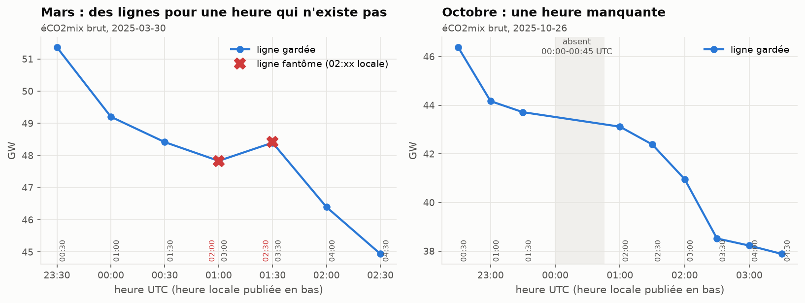
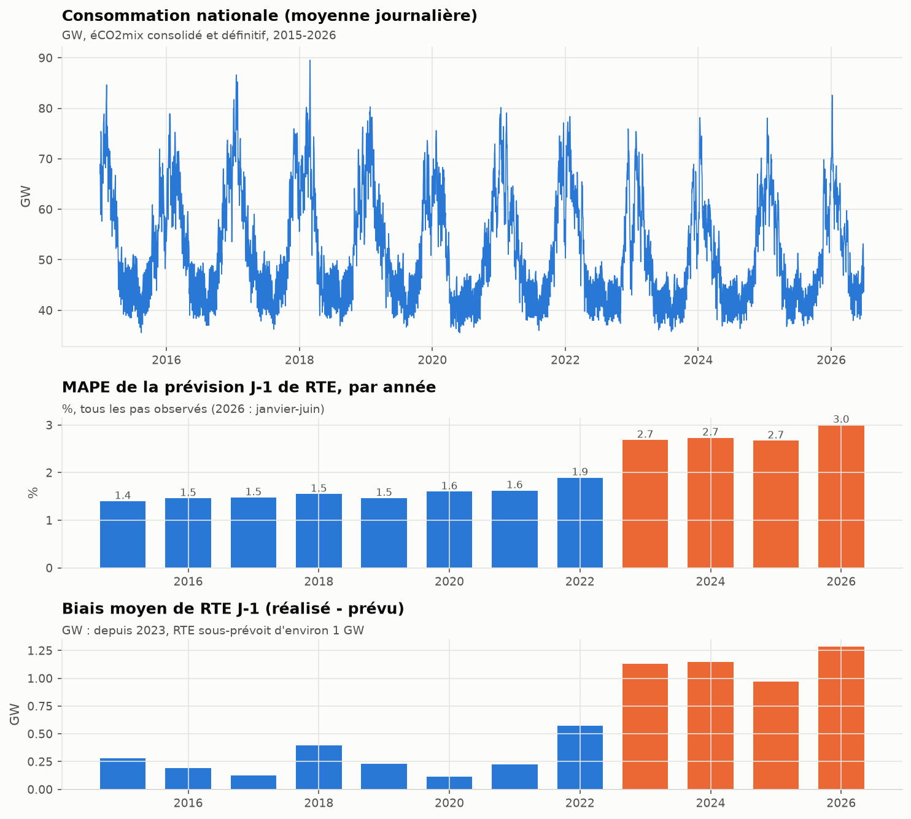
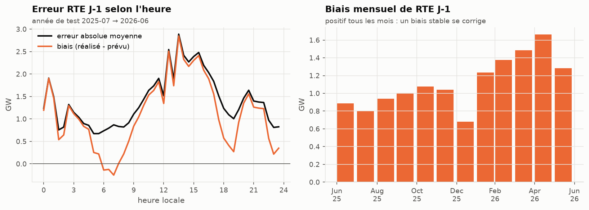
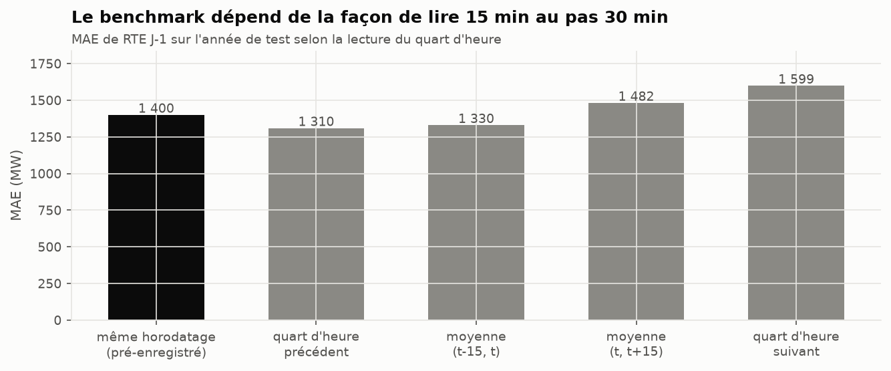
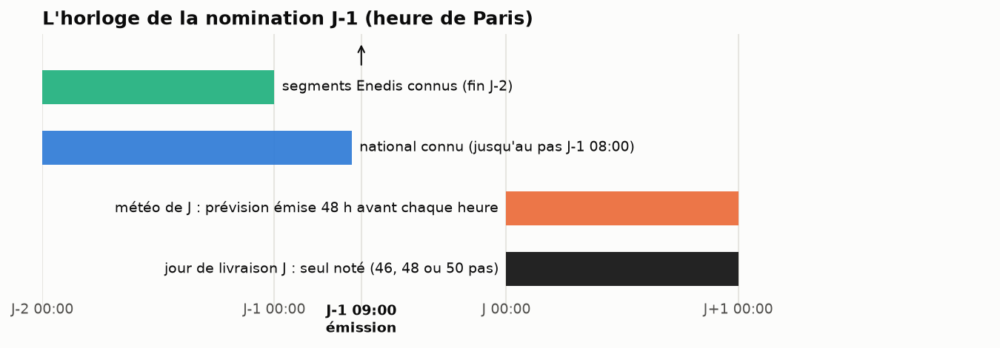
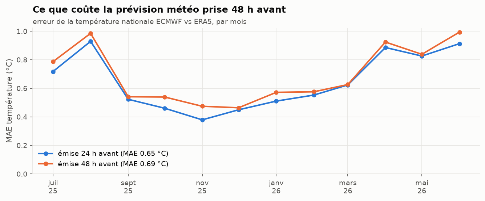
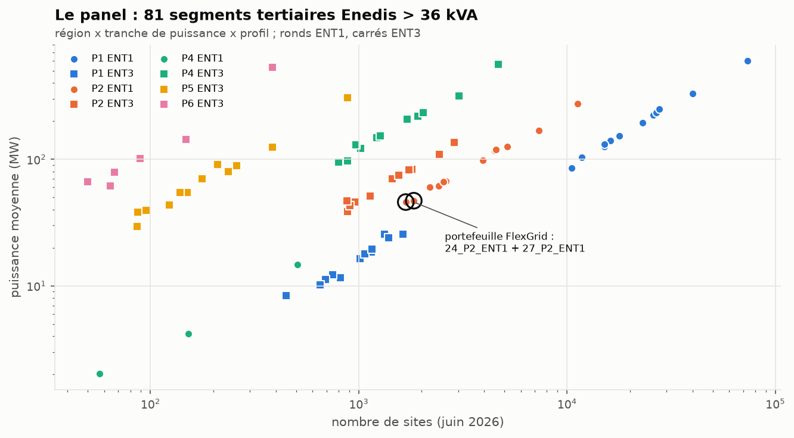
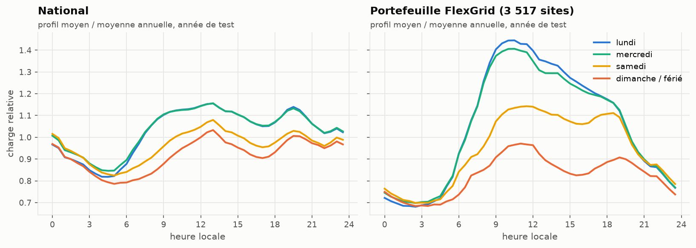
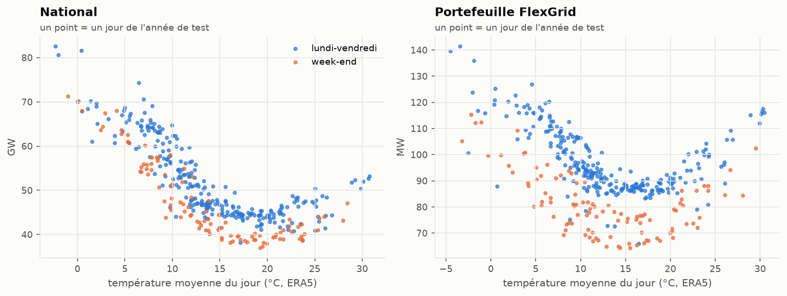
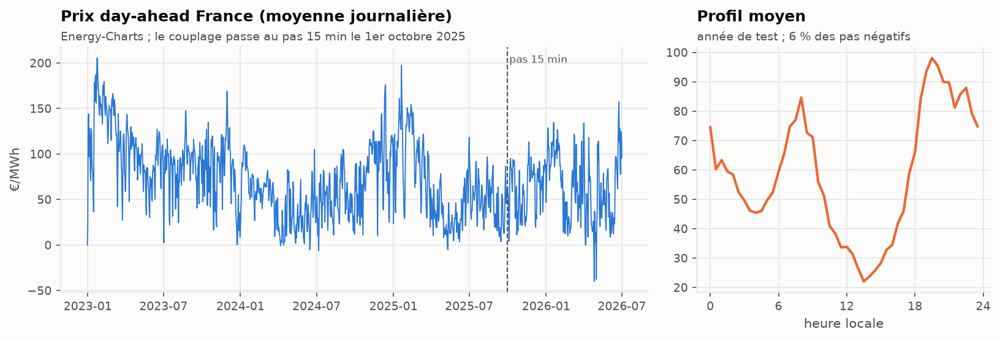

# Bloc A : les données, avant tout modèle

Ce bloc répond à une question : **qu'est-ce que les sources contiennent vraiment, et qu'est-ce que cela impose au
protocole ?** Tous les chiffres viennent de `uv run flexgrid build` puis `uv run flexgrid figures-data`. L'année
de test va du 1er juillet 2025 au 30 juin 2026.

## Ce qu'il faut retenir

1. Le bug de l'heure d'été attendu par le brief est **dans la source**, pas dans notre code. Il se répare par une
   règle explicite.
2. La prévision J-1 de RTE, le benchmark à battre, a un **biais stable d'environ +1,1 GW depuis 2023**. La battre
   brute ne prouverait pas grand-chose : on la bat aussi débiaisée, ou on ne dit pas qu'on la bat.
3. **La façon de lire une prévision au quart d'heure sur un pas de 30 min déplace son MAE de 6,5 %.** Le verdict
   doit tenir sous les deux lectures.
4. Le portefeuille FlexGrid (tertiaire) n'a pas la forme du national : un pic de bureau en semaine, un dimanche
   plat, une thermosensibilité en hiver **et** en été (climatisation).

## 1. Les heures qui n'existent pas, et celle qui manque

Le 30 mars 2025, l'horloge passe de 02:00 à 03:00. Pourtant éCO2mix publie des lignes « 02:00 » et « 02:30 »
locales, converties sur le même instant UTC que « 03:00 » et « 03:30 » (croix rouges). Leurs valeurs recopient des
voisines. Sur 2015-2026, cela fait **48 horodatages UTC en double**. Un `pivot` ou un `reindex` sur ces données
plante, ou pire, moyenne silencieusement une vraie valeur et une fausse.

Le 26 octobre 2025, l'heure 02:00-03:00 locale est jouée deux fois. éCO2mix n'en publie qu'une : **00:00-00:45 UTC
manque** (zone grise), chaque année.

Règle appliquée (`flexgrid.data.national`) :
- on reconstruit l'instant à partir de l'heure locale, et on écarte les lignes dont l'heure locale n'existe pas ;
- on travaille en UTC, où il n'y a ni doublon ni trou d'horloge ;
- le trou d'octobre (2 pas) est interpolé pour servir d'entrée, mais il est marqué non observé : **il n'est
  jamais noté comme cible**.

La série nationale 2015-2026 a douze trous : les onze nuits d'octobre de 2015 à 2025, et un pas isolé le
31 décembre 2025 à 23:00 UTC. Les agrégats Enedis, eux, sont propres : 46 pas en mars, 50 en octobre.

## 2. Le benchmark : RTE J-1

De 2015 à 2021, la prévision J-1 de RTE a un MAPE de 1,4 à 1,6 %. Depuis 2023, il est d'environ 2,7 %, et la
prévision sous-estime le réalisé d'environ 1 GW en moyenne. Sur l'année de test : **MAE 1 400 MW, MAPE 2,79 %,
biais +1 120 MW**.

L'erreur n'est pas uniforme dans la journée. Le biais est presque nul à 7 h, et culmine entre 12 h et 16 h, avec
des pics nets à 00:30, 12:30 et 13:30. Ce sont des heures de bascule, ce qui évoque des usages pilotés par signal
tarifaire (ballons d'eau chaude, heures creuses déplacées vers la mi-journée). Le pic de mi-journée suggère aussi
l'autoconsommation solaire, que le réalisé et la prévision ne traitent peut-être pas de la même façon.
**Ce sont des hypothèses** : les données publiques ne permettent pas de trancher, et on ne s'en sert que pour une
conclusion pratique. Ce biais est stable d'un mois à l'autre (positif chaque mois), donc il se corrige.

D'où le second benchmark, **RTE débiaisée** : on retranche à la prévision RTE l'erreur moyenne des 28 derniers jours
connus, pour chaque demi-heure de la journée. C'est ce qu'un BRP ferait en une ligne de code.

## 3. Lire un quart d'heure au pas de 30 minutes

La conso réalisée est au pas 30 min, la prévision RTE au pas 15 min. Prendre le quart d'heure de même horodatage
(lecture pré-enregistrée) donne un MAE de 1 400 MW. Prendre le quart d'heure précédent donne **1 310 MW**. Rien
dans la documentation ne tranche entre les deux. Notre règle est donc la plus exigeante pour nous : un modèle ne
« bat RTE » que s'il bat les deux lectures.

## 4. Ce que l'on sait à 9 h la veille

La prévision est émise à 9 h la veille, avant la clôture du marché day-ahead à midi. À ce moment :
- la conso nationale est connue jusqu'au pas de 08:00 ;
- les courbes de charge des sites du portefeuille ne sont connues que jusqu'à la fin de J-2 (télérelève) ;
- la météo de J est une prévision.

La prévision émise 24 h avant n'est pas encore publiée à 9 h la veille pour la plupart des heures de J. On prend donc
partout celle émise 48 h avant. Ce choix prudent coûte peu : l'erreur sur la température nationale passe de 0,65 °C
à 0,69 °C. L'erreur est plus forte en été, quand la température moyenne nationale dépend d'orages locaux.

## 5. Le portefeuille FlexGrid

Enedis publie, au pas 30 min, la consommation agrégée des sites de plus de 36 kVA par région, tranche de puissance,
profil et secteur. On garde le tertiaire, et 81 segments sur 120 : les autres ont moins de 50 sites, des valeurs
masquées par le secret statistique (jusqu'à 58 % des pas), ou aucun site. Le portefeuille FlexGrid est la somme de deux
segments (cercles noirs) : **3 517 sites, 815 GWh/an**.

Le tertiaire n'a pas la forme du national. Son pic de semaine monte à 1,45 fois la moyenne vers 10 h, et le samedi
n'atteint qu'un peu plus de la moitié de l'amplitude d'un jour ouvré. Le dimanche et les jours fériés sont plats. Le calendrier compte donc beaucoup
plus pour le portefeuille que pour le national.

Les deux séries chauffent en hiver. Le portefeuille climatise aussi en été : au-dessus de 20 °C, sa consommation
remonte de 85 à 115 MW, alors que le national remonte à peine. Une variable « degrés-jours de chauffage » seule ne
suffit pas.

## 6. Le prix, pour passer de MW à €

Le prix day-ahead vient d'Energy-Charts (sans token). Il passe au pas 15 min le 1er octobre 2025 ; on le ramène au
pas 30 min par moyenne. Son profil est en double bosse (8 h, 20 h) avec un creux solaire à 13 h. Une erreur de
prévision ne coûte donc pas pareil à toute heure : le coût en € n'est pas un MAE déguisé.

## Déviation déclarée

Le contrôle de plage pré-enregistré pour les segments ([0,05 ; 5] × médiane) retirait 7 399 pas **réels** du
segment 84_P4_ENT1. Ce segment est chauffé à l'électricité : son hiver vaut 6 fois son été. La règle a été remplacée
avant toute prévision par [0,05 × médiane ; 2 × quantile 99,9 %], qui ne retire plus aucun pas. Elle est datée dans
`configs/protocol.yaml` et dans [`IMPLEMENTATION_NOTES.md`](../IMPLEMENTATION_NOTES.md).
