# Blocs B et C : modèles et backtest

Rolling-origin sur **365 jours de livraison** (1er juillet 2025 → 30 juin 2026), prévision émise chaque veille à
9 h, précédés de 181 jours de validation (janvier-juin 2025) qui servent au router et à la calibration conforme.
Commandes : `flexgrid forecast <famille> <modèles>`, puis `flexgrid score national segments`. Les nombres viennent
de `results/summary_national.csv` et `results/verdicts_national.csv`. Timestral et TimesFM 3.0, ajoutés le
2026-10-16, ont leur [propre section](#addendum-du-2026-10-16-timestral-et-timesfm) à la fin.

## La réponse en une phrase (national)

> Nos meilleurs modèles battent nettement la prévision J-1 publiée par RTE : le mélange LightGBM + Chronos-2 a un
> MAE de 897 MW contre 1 400 MW (ratio 0,64, IC 95 % [0,56 ; 0,73]), sous les deux lectures du quart d'heure, avec
> une couverture 90 % de 0,86, dans la bande pré-enregistrée. **Mais une correction de biais d'une ligne appliquée à
> RTE fait mieux que tous nos modèles** : 816 MW. Contre elle, le mélange ne montre « pas de différence »
> (1,10 [0,99 ; 1,22]) sous la lecture pré-enregistrée, et **perd** sous la lecture favorable à RTE (1,14 [1,02 ; 1,26]).

Le critère du brief, « battre la prévision J-1 de RTE », est donc rempli au sens littéral et ne l'est pas au sens
utile. Le sens utile est le seul qui compte pour un BRP : il peut corriger RTE lui-même. Sur le national, la valeur
démontrable de nos modèles ne vient pas de la précision ponctuelle, elle vient de :
- **l'été**, où le mélange bat RTE débiaisée (592 MW contre 706 MW de juillet à octobre) ;
- **les quantiles**, que RTE ne publie pas ;
- **le portefeuille**, où RTE n'existe pas (section suivante).

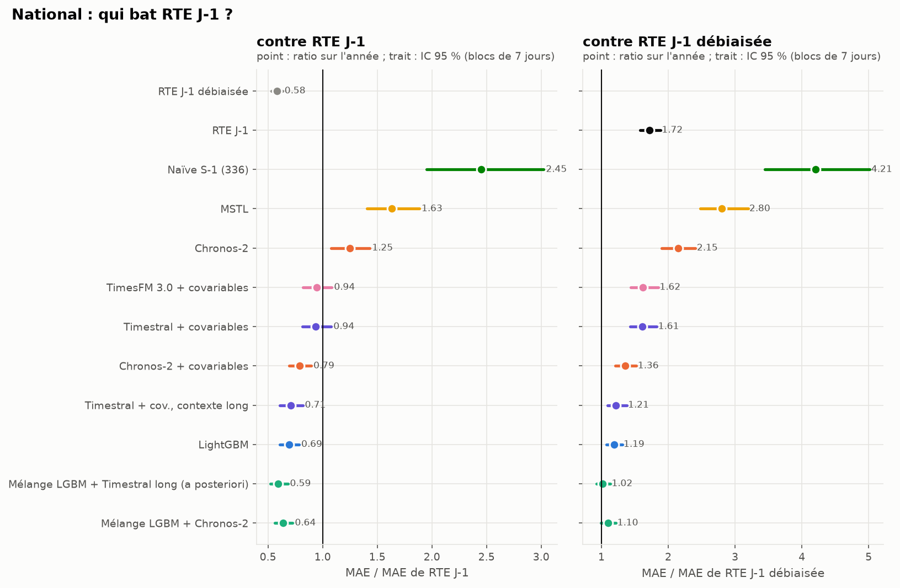

## Ce que montre chaque figure

### L'erreur selon l'heure

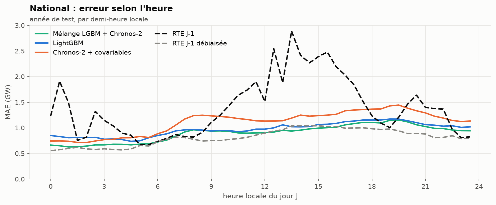

La prévision RTE brute (tirets noirs) a la signature de son biais : des pics à 00:30, 12:30-13:30 et un plateau
l'après-midi, ceux vus au bloc A. Débiaisée (tirets gris), elle est la meilleure courbe de 7 h à 13 h, quand les
usages tertiaires démarrent. Nos modèles ne voient la conso nationale que jusqu'à 8 h la veille ; RTE, elle, révise
sa prévision plus tard et avec sa propre télémesure (SPEC, angle mort 5). La nuit, le mélange fait jeu égal.

### Mois par mois

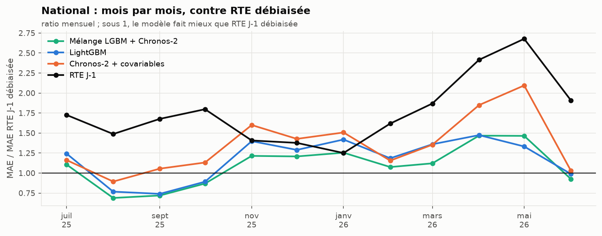

Sous 1, le modèle fait mieux que RTE débiaisée. Le mélange gagne d'août à octobre et en juin, perd tout l'hiver et
au printemps. Sur l'année, il fait mieux qu'elle un jour sur deux (50,7 % des jours) mais perd en moyenne : ses
mauvais jours sont des jours d'hiver, où les erreurs se comptent en GW. L'hiver est la saison où une erreur de température coûte le plus (2 à 3 GW par degré en France) ; c'est
aussi celle où l'information fraîche de RTE vaut le plus. En avril-mai, RTE brute se dégrade (ratio 2,7) : son biais
augmente, et la correction glissante sur 28 jours le suit.

### Par type de jour

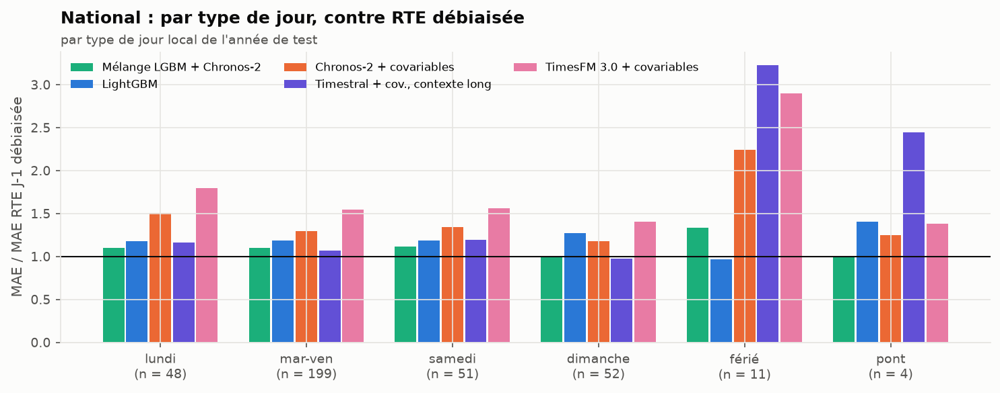

Chronos-2, même informé des fériés par une covariable, se trompe lourdement les jours fériés (ratio 2,25 contre RTE
débiaisée, n = 11). LightGBM, qui a vu dix ans de fériés dans son apprentissage, est le seul à faire jeu égal ces
jours-là (0,97). Le jour de Noël ci-dessous le montre : Chronos-2 prévoit presque un jeudi ordinaire.

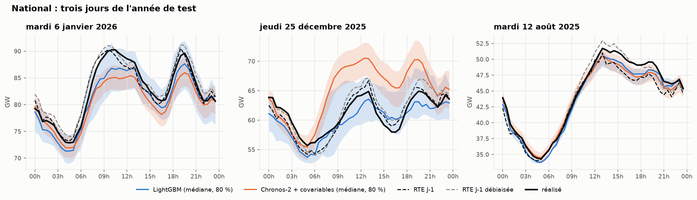

### Les intervalles

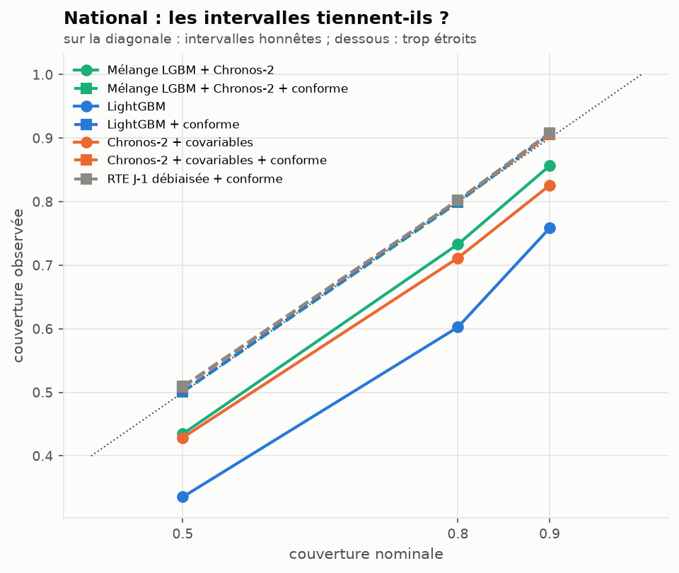

- **LightGBM brut est trop sûr de lui** : son intervalle 90 % ne couvre que 76 % des pas. L'angle mort 7 du SPEC
  annonçait un décalage train/serve (appris sur météo observée, utilisé sur météo prévue). Le décalage existe, mais
  il n'explique pas tout : avec la météo observée en entrée, la couverture n'est que de 77 %. L'essentiel vient de la
  régression quantile elle-même, qui s'ajuste trop bien à ses données d'apprentissage.
- Le mélange couvre 86 % (dans la bande), Chronos-2 avec covariables 83 %.
- **La réparation conforme** (médiane conservée, quantiles reconstruits sur les erreurs des 56 derniers jours)
  ramène tous les modèles à 0,906-0,908. Appliquée à RTE débiaisée, elle donne la meilleure pinball loss du national
  (238 MW contre 267 pour le mélange) : sur le national, même la prévision probabiliste la plus utile est une RTE
  corrigée.

### La météo parfaite n'aurait presque rien changé

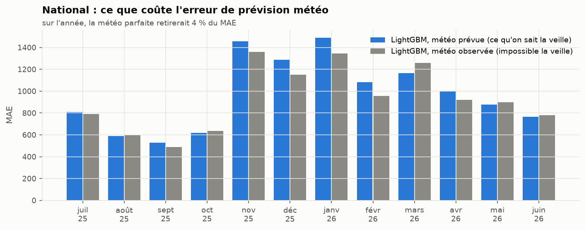

Les mêmes modèles LightGBM, nourris avec la météo observée au lieu de la météo prévue 48 h avant, ne gagnent que
4 % de MAE (933 contre 972 MW). L'erreur de prévision météo n'est donc pas ce qui sépare nos modèles de RTE.
Ce qui les sépare, c'est l'information sur la conso elle-même : à quelle heure on la connaît, et à quel niveau de
détail.

## Les autres modèles

| Modèle | MAE (MW) | MAPE | MASE | couverture 90 % |
|---|---|---|---|---|
| RTE J-1 débiaisée | 816 | 1,61 % | 0,233 | (ponctuelle) |
| Mélange LightGBM + Chronos-2 | 897 | 1,73 % | 0,256 | 0,857 |
| LightGBM | 972 | 1,87 % | 0,277 | 0,758 |
| Chronos-2 + covariables | 1 109 | 2,15 % | 0,316 | 0,826 |
| RTE J-1 publiée | 1 401 | 2,79 % | 0,399 | (ponctuelle) |
| Chronos-2 sans covariables | 1 752 | 3,33 % | 0,499 | 0,811 |
| MSTL | 2 284 | 4,47 % | 0,651 | 0,786 |
| Naïve J-1, naïve S-1, ETS saisonnier | 3 430-3 493 | 6,4-7,1 % | 0,98-1,00 | 0,70-0,88 |

- **Les covariables comptent plus que le modèle** : Chronos-2 passe de 1 752 à 1 109 MW quand on lui donne la
  météo et le calendrier. Zero-shot sans covariables, un TSFM ne sait pas qu'il va faire froid demain.
- **MSTL et ETS ne font pas mieux que la naïve d'un facteur 2.** Sans météo, un modèle univarié ne peut pas suivre
  un hiver.
- **Le mélange bat ses deux membres.** LightGBM et Chronos-2 se trompent à des moments différents ; la moyenne des
  quantiles réduit le MAE de 8 % par rapport au meilleur des deux.

## Le portefeuille FlexGrid

Nombres : `results/summary_portfolio.csv`, `results/verdicts_portfolio.csv`, `results/summary_panel.csv`.

### La réponse en une phrase (portefeuille)

> Sur le portefeuille (3 517 sites tertiaires, ~93 MW en moyenne), le mélange a un MAPE de **2,72 %**, contre
> **5,59 %** pour la prévision de RTE ramenée au portefeuille et **7,55 %** pour la naïve hebdomadaire. Son MAE vaut
> 0,49 fois celui de RTE au prorata (IC 95 % [0,44 ; 0,54]) et 0,36 fois celui de la naïve ([0,32 ; 0,40]), avec une
> couverture 90 % de 0,85 dans la bande.

Ici, contrairement au national, il n'y a pas de RTE débiaisée qui tienne : RTE ne prévoit pas le portefeuille. Le
meilleur raccourci d'un BRP sans modèle, « RTE J-1 × la part récente du portefeuille, par demi-heure » (ajouté
après le protocole, voir les notes d'implémentation), fait 5,6 % : c'est presque exactement les 6 % du brief. **Le
MAPE de 6 % décrit dans le brief est donc celui d'une méthode sans modèle, et un modèle le divise par deux.**

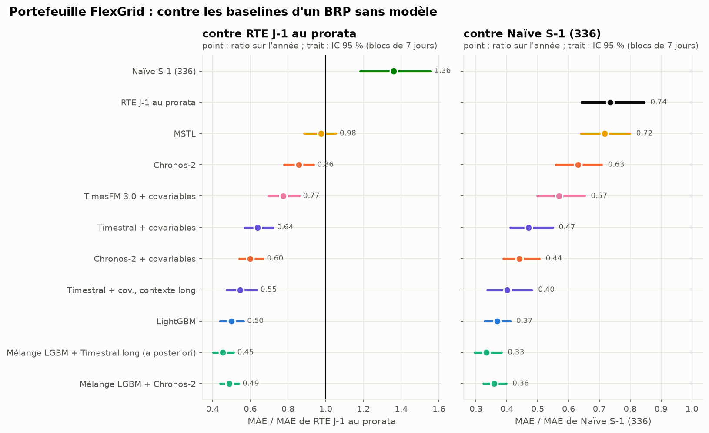

Pourquoi l'écart est-il bien plus grand ici que sur le national ? Le portefeuille ne ressemble pas à la France :
pic de bureau, dimanche plat, climatisation (bloc A). Une prévision nationale, même mise à l'échelle par demi-heure,
porte la forme du national. Et l'information fraîche de RTE ne vaut rien pour ces 3 517 sites-là.

### L'erreur selon l'heure

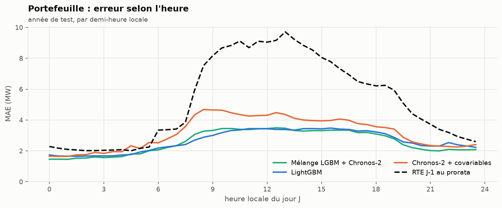

RTE au prorata se trompe surtout aux heures ouvrées (8 h-19 h), là où le profil tertiaire s'écarte le plus du
profil national. Nos modèles ont une erreur presque plate le jour, autour de 3,5 MW.

### Mois par mois, et par type de jour

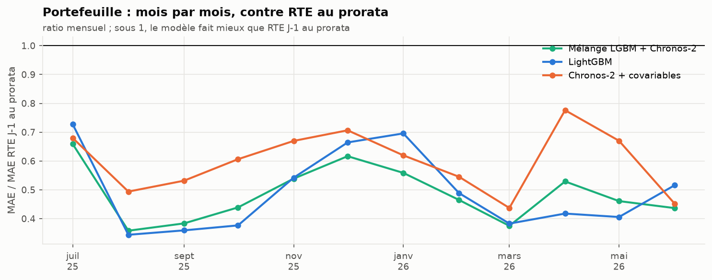

Le mélange bat RTE au prorata tous les mois (et 86 % des jours). L'hiver reste la saison difficile en valeur
absolue (MAE de 3,38 MW de décembre à février contre 2,05 MW en juillet-août), mais l'avantage relatif ne disparaît
pas comme sur le national.

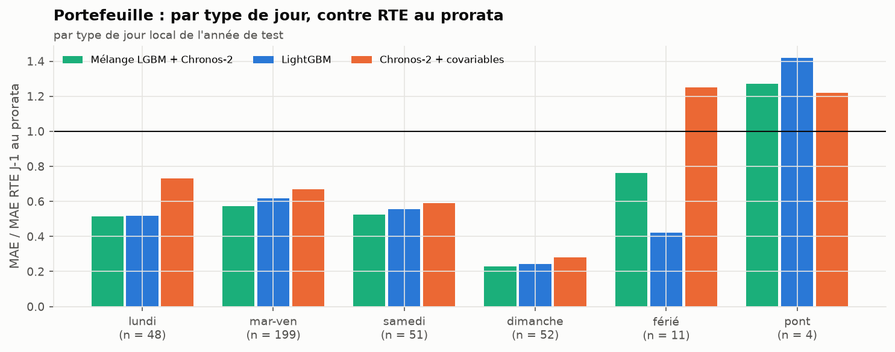

Les jours fériés (n = 11) et les ponts (n = 4) sont les seuls où l'un de ces modèles perd. Sur les ponts, tous perdent contre
RTE au prorata : un pont dans le tertiaire, c'est la moitié des bureaux fermés, ce qu'aucune variable du calendrier
ne mesure bien. Sur les fériés, LightGBM (0,42) fait bien mieux que Chronos-2 (1,25), comme sur le national.
Noël le montre :

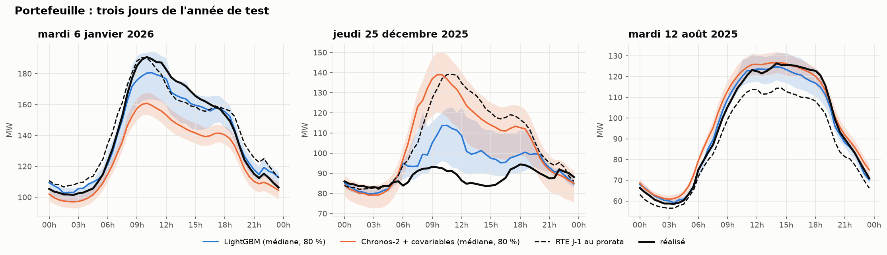

Le 25 décembre, Chronos-2 et RTE au prorata prévoient une journée de travail (MAE de 19 MW). LightGBM sait que
c'est férié (8 MW) ; le mélange, qui moyenne les deux, est entre les deux (14 MW). **Le mélange hérite des erreurs
de Chronos-2 les jours fériés** : une règle « LightGBM seul les jours fériés » serait un gain facile, non
pré-enregistré, donc pas appliqué ici.

### Les intervalles

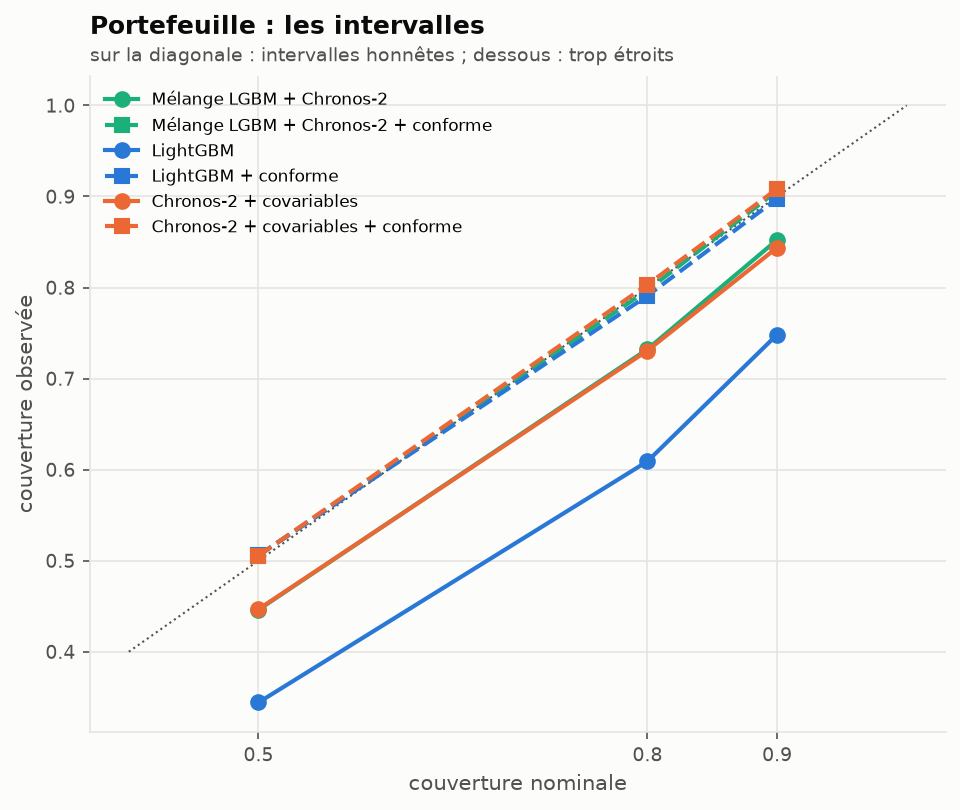

Même diagnostic qu'au national : LightGBM couvre 75 % au lieu de 90 % (76 % au national), le mélange 85 %, Chronos-2 + covariables
84 %. La réparation conforme ramène tous les modèles à 0,90-0,91. Mois par mois, la couverture réparée du mélange
descend à 0,78 en novembre : la fenêtre de 56 jours suit l'arrivée de l'hiver avec retard.

### La météo parfaite

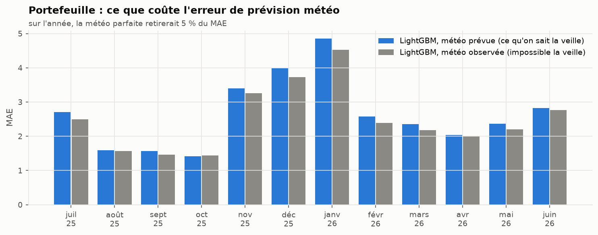

Même conclusion qu'au national : la météo observée ne retire que 5 % du MAE. En MW, le gain est le plus grand en
hiver ; en proportion, il est du même ordre (6 à 8 %) en hiver, au printemps et en juillet.

### Le panel : LightGBM ou Chronos-2, segment par segment

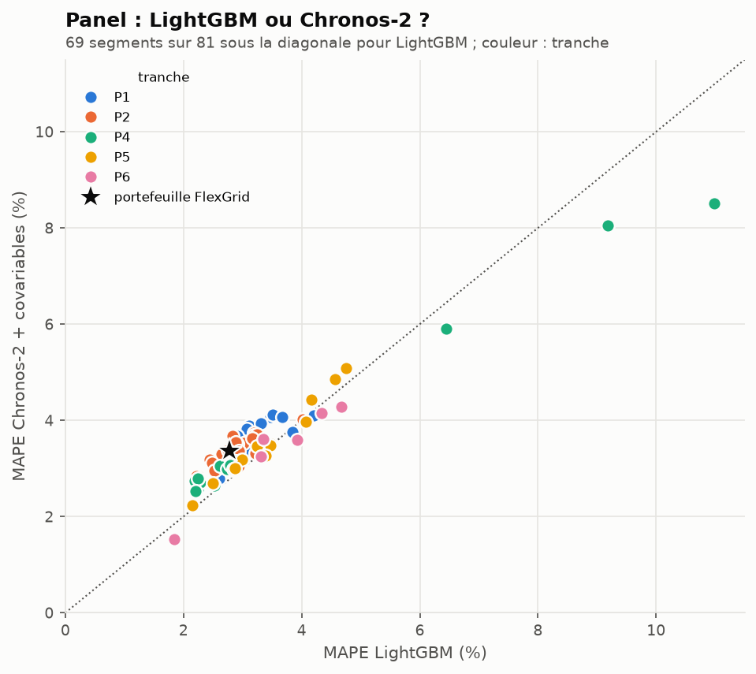

Sur les 81 segments du panel, LightGBM a un MAPE plus faible que Chronos-2 + covariables sur 69. Les exceptions ne
sont pas au hasard : **les trois segments P4 chauffés à l'électricité** (84, 76, 93_P4_ENT1), les plus difficiles
du panel (MAPE de 6 à 11 %), sont mieux prévus par Chronos-2. Le mélange fait mieux que LightGBM seul sur 72
segments sur 81. C'est la question du router (bloc 03) : y a-t-il des segments où il vaut mieux choisir un modèle
plutôt que les mélanger ?

| Portefeuille, année de test | MAE (MW) | MAPE | MASE | couverture 90 % |
|---|---|---|---|---|
| Mélange LightGBM + Chronos-2 | 2,57 | 2,72 % | 0,371 | 0,852 |
| LightGBM | 2,64 | 2,78 % | 0,381 | 0,748 |
| Chronos-2 + covariables | 3,16 | 3,36 % | 0,457 | 0,844 |
| Chronos-2 sans covariables | 4,53 | 4,77 % | 0,654 | 0,875 |
| MSTL | 5,15 | 5,39 % | 0,743 | 0,955 |
| RTE J-1 au prorata | 5,28 | 5,59 % | 0,761 | (ponctuelle) |
| Naïve S-1 | 7,17 | 7,55 % | 1,035 | 0,866 |
| ETS saisonnier | 10,48 | 11,27 % | 1,513 | 0,832 |
| Naïve J-1 | 12,42 | 12,90 % | 1,794 | 0,874 |

## Addendum du 2026-10-16, Timestral et TimesFM

Deux TSFM sont sortis après la fin du projet : **TimesFM 3.0** (Google Research, 31 août 2026) et **Timestral**
(Mistral AI, 15 octobre 2026). Ils ont été ajoutés par un addendum au protocole, écrit avant leur première
prévision (`configs/protocol.yaml`, `addendum_2026_10_16`), avec les mêmes origines, les mêmes entrées et les
mêmes réglages publiés par défaut que Chronos-2. Chaque TSFM est testé sans covariables, avec la météo, avec la
météo et le calendrier (fériés, ponts, vacances scolaires, week-end), et avec son contexte maximal (Chronos-2
8 192 pas, TimesFM 15 360, Timestral 32 768). Timestral-5M, la plus petite version, tourne sur CPU.

Commandes : `uv run flexgrid forecast national|segments <modèle>`, puis `score` et `tables`. Nombres :
`results/tsfm_grid_{national,portfolio}.csv`, `results/calendar_ablation_{national,portfolio}.csv`,
`results/verdicts_{national,portfolio}.csv`, `results/production_switch.csv`.

### 1. Un nouveau TSFM bat-il Chronos-2 ?

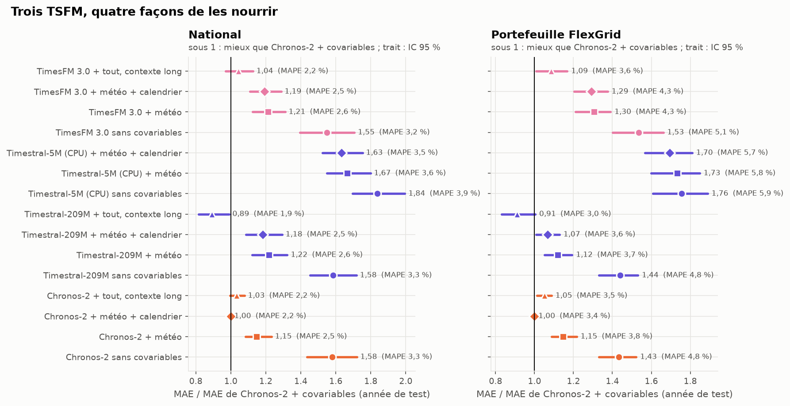

**À contexte égal (2 048 pas), non.** Avec météo et calendrier, Timestral fait 1,18 fois le MAE de Chronos-2
au national (IC 95 % [1,09 ; 1,29]) et 1,07 sur le portefeuille ([1,01 ; 1,13]) ; TimesFM 3.0 fait 1,19
([1,11 ; 1,29]) et 1,29 ([1,20 ; 1,38]). Sans covariables, les trois se valent (1,55 à 1,59 au national) :
l'écart vient de la façon dont chaque modèle lit les covariables, pas de la prévision univariée.

**Avec tout son contexte, Timestral passe devant.** À 32 768 pas (presque deux ans), Timestral fait 990 MW au
national, 0,89 fois Chronos-2 ([0,82 ; 0,99]), et 0,91 sur le portefeuille ([0,83 ; 1,00], pas de différence
nette). Plus de contexte n'aide ni Chronos-2 (1,03) ni TimesFM 3.0 (1,04) : c'est propre à Timestral.

| National, année de test | MAE (MW) | MAPE | couverture 90 % | contre RTE J-1 publiée | contre RTE débiaisée |
|---|---|---|---|---|---|
| Chronos-2 + covariables (rappel) | 1 109 | 2,15 % | 0,83 | 0,79, gagne | perd |
| Timestral + covariables | 1 312 | 2,51 % | 0,96 | 0,94 [0,82 ; 1,08], pas de différence | 1,61, perd |
| TimesFM 3.0 + covariables | 1 323 | 2,53 % | 0,89 | 0,95 [0,82 ; 1,09], pas de différence | 1,62, perd |
| Timestral, contexte long | 990 | 1,92 % | 0,95 | **0,71 [0,61 ; 0,82], gagne** | 1,21 [1,09 ; 1,38], perd |
| TimesFM 3.0, contexte long | 1 158 | 2,24 % | 0,89 | 0,83 [0,73 ; 0,94], gagne | 1,42, perd |
| Timestral-5M + covariables (CPU) | 1 809 | 3,51 % | 0,87 | 1,29 [1,16 ; 1,44], perd | 2,22, perd |

Les intervalles bruts de Timestral sont **trop larges** (couverture 0,95-0,96 au lieu de 0,90), à l'inverse de
LightGBM. TimesFM 3.0 n'émet que les quantiles 0,1 à 0,9 : ses q0,05 et q0,95 sont extrapolés sous une hypothèse
gaussienne (notes d'implémentation), et sa couverture brute en dépend. Timestral-5M ne bat même pas RTE publiée ;
sur le portefeuille, il est au niveau de RTE au prorata (1,02 [0,93 ; 1,11]).

### 2. Le calendrier en covariable aide-t-il les jours fériés ?

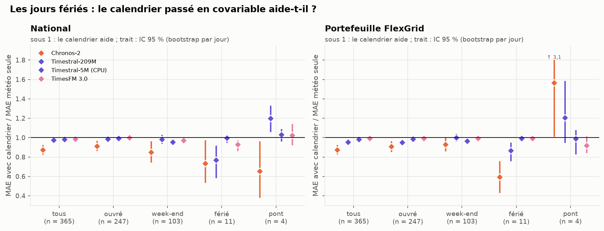

Ratio du MAE avec météo et calendrier sur le MAE avec la météo seule. Sous 1, le calendrier aide.

| | tous les jours, national | fériés, national (n = 11) | tous les jours, portefeuille | fériés, portefeuille |
|---|---|---|---|---|
| Chronos-2 | 0,87 [0,82 ; 0,92] | 0,73 [0,53 ; 0,97] | 0,87 [0,83 ; 0,93] | 0,59 [0,43 ; 0,76] |
| Timestral | 0,97 [0,95 ; 1,00] | 0,77 [0,58 ; 0,92] | 0,95 [0,93 ; 0,97] | 0,87 [0,76 ; 0,95] |
| TimesFM 3.0 | 0,99 [0,97 ; 1,00] | 0,93 [0,86 ; 0,97] | 0,99 [0,98 ; 1,00] | 0,99 [0,97 ; 1,01] |

- **Le calendrier aide chaque TSFM les jours fériés, mais pas assez.** Il retire un quart de l'erreur de
  Chronos-2 et de Timestral ces jours-là au national, presque rien à TimesFM 3.0. Même avec lui, les TSFM restent
  loin de LightGBM les jours fériés (figure *par type de jour* plus haut) : une covariable binaire « férié » ne
  remplace pas dix ans de fériés vus à l'apprentissage.
- **La météo compte plus que le calendrier** : elle retire 22 à 27 % du MAE des trois TSFM au national (ratios
  météo / sans covariables de 0,73 à 0,78), le calendrier 1,5 à 13 %.
- Sur les 4 ponts, le calendrier dégrade Timestral (1,20 [1,06 ; 1,33] au national). Quatre jours ne permettent
  pas d'en tirer une règle ; l'addendum l'avait écrit d'avance.

### 3. Les nouveaux TSFM améliorent-ils le mélange ?

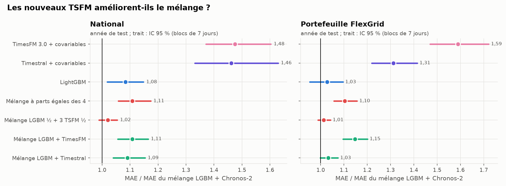

Non. Aucun mélange pré-enregistré de l'addendum ne fait mieux que LightGBM + Chronos-2, ni au national (le
meilleur, LightGBM ½ + trois TSFM ⅙, fait 916 MW contre 897) ni sur le portefeuille (1,01 [0,99 ; 1,04]). Le
service garde donc le mélange d'origine (règle de bascule pré-enregistrée, [05_production](../05_production/README.md)).

**Un résultat exploratoire, déclaré comme tel** : le mélange LightGBM + Timestral à contexte long, construit
*après* avoir vu que Timestral long fait presque aussi bien que LightGBM, est le meilleur modèle du dépôt. Au
national, 832 MW, et **pas de différence avec RTE débiaisée** (1,02 [0,92 ; 1,13], 1,06 [0,96 ; 1,17] sous
l'autre lecture du quart d'heure), là où le mélange d'origine perdait sous cette lecture. Sur le portefeuille,
MAPE de 2,5 % et 0,93 fois le MAE du mélange d'origine ([0,89 ; 0,98]). Comme il a été choisi en regardant
l'année de test, ce chiffre est optimiste ; il ne compte dans aucun verdict, et il ne sera crédible qu'évalué sur
une fenêtre qu'il n'a pas vue.

### Ce qu'on retient

1. **Le TSFM ne change pas la conclusion, la manière de l'utiliser si.** À réglages égaux, Chronos-2 reste le
   meilleur des trois. Ce qui fait gagner Timestral, c'est un contexte de deux ans que les autres n'exploitent pas.
2. **Les covariables pèsent plus que le modèle** (déjà vrai pour Chronos-2) : sans covariables, les trois TSFM
   sont à égalité.
3. **Les jours fériés restent le point faible de tous les TSFM**, même informés par le calendrier.
