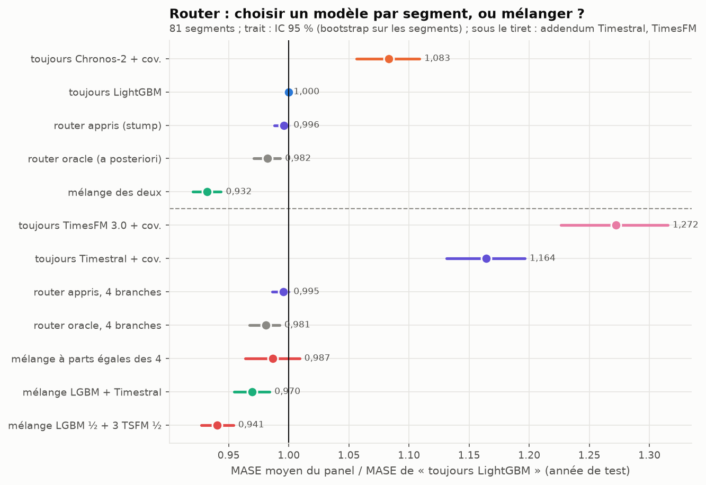
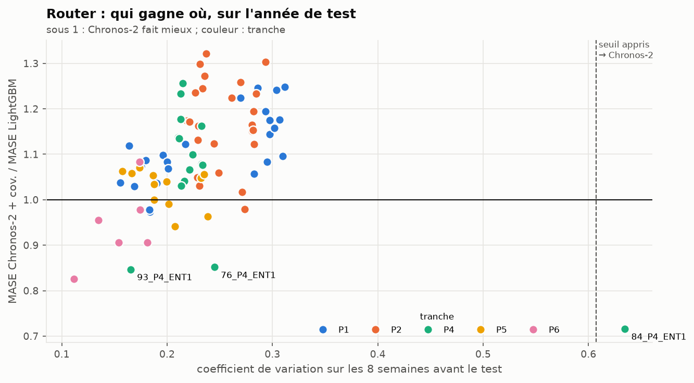
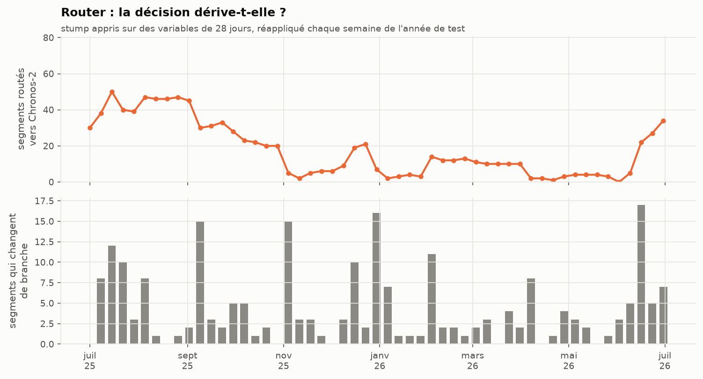
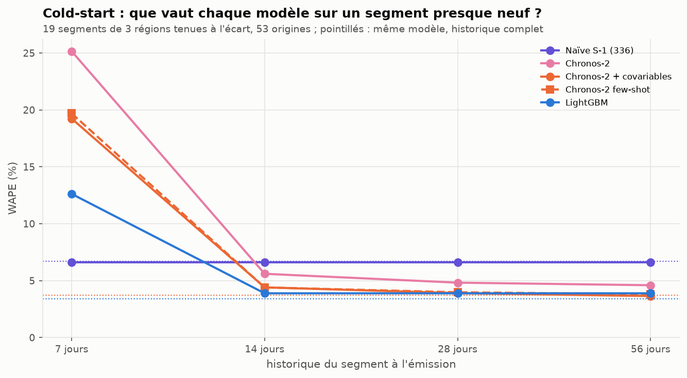

# Router et cold-start : choisir un modèle par segment, et prévoir un site presque neuf

Deux questions du brief (bloc B) sur le panel des 81 segments tertiaires Enedis :
1. **Complexity Router.** Faut-il, segment par segment, choisir entre le spécialiste (LightGBM) et le TSFM
   (Chronos-2 + covariables) ?
2. **Cold-start.** Que vaut chaque modèle quand un segment n'a que quelques jours d'historique, et le
   « few-shot in-context » de Chronos-2 aide-t-il ?

Commandes : `uv run flexgrid router`, `uv run flexgrid coldstart`, puis `uv run flexgrid figures-router`.
Nombres : `results/router_summary.json`, `results/router_units.csv`, `results/router_drift.csv`,
`results/coldstart_summary.csv`.

## 1. Le router

### Ce qui a été pré-enregistré

- Unités : les 81 segments du panel (le portefeuille FlexGrid est exclu, il sert au verdict).
- Variables ex-ante, calculées sur les 8 semaines qui précèdent la période routée : nombre de sites, puissance
  moyenne, force des saisonnalités journalière et hebdomadaire, coefficient de variation, bruit de la naïve,
  sensibilité à la température.
- Étiquette : la branche au MASE moyen le plus bas **sur la fenêtre de validation** (janvier-juin 2025).
- Modèle de routage : un *stump* (une variable, un seuil), appris sur la validation, appliqué tel quel au test.
  Un stump plutôt qu'un arbre : 81 unités ne permettent pas d'en apprendre plus sans sur-apprendre.
- Politiques comparées sur l'année de test : toujours LightGBM, toujours Chronos-2, le stump, l'oracle (la
  meilleure branche a posteriori, une borne qu'aucune politique ne peut dépasser) et le mélange des deux.

### Le résultat : mélanger bat choisir, même en trichant

| Politique (MASE moyen / toujours LightGBM) | ratio | IC 95 % |
|---|---|---|
| toujours Chronos-2 + covariables | 1,083 | [1,056 ; 1,109] |
| router appris (stump) | 0,996 | [0,988 ; 1,000] |
| router oracle (a posteriori) | 0,982 | [0,971 ; 0,993] |
| **mélange des deux** | **0,932** | [0,920 ; 0,944] |

- Le stump appris route **un seul segment** vers Chronos-2 (coefficient de variation ≥ 0,61 : 84_P4_ENT1). Il gagne
  0,4 % sur « toujours LightGBM ».
- Même le router oracle, qui connaît la bonne réponse, ne gagne que 1,8 %. **Le plafond du routage est bas** :
  LightGBM a le MASE moyen le plus bas sur 66 segments sur 81, et là où Chronos-2 gagne, il gagne peu.
- Le mélange gagne 6,8 %, quatre fois l'oracle. Il bat l'oracle sur 70 segments sur 81. Deux modèles qui se trompent
  à des moments différents se corrigent l'un l'autre *dans le temps*, alors qu'un router ne peut choisir qu'une
  fois par segment.

### Qui gagne où

En MASE, Chronos-2 fait mieux que LightGBM sur 15 segments (12 en MAPE, bloc C). Ce ne sont pas des segments au hasard : les trois segments
**P4 chauffés à l'électricité** (84, 76, 93_P4_ENT1, ceux du bloc A) et 5 des 6 segments **P6** (les plus
gros sites). Ce sont les segments dont la forme change le plus avec la saison. Le stump n'en attrape qu'un : les
deux autres P4 ont un coefficient de variation banal sur les 8 semaines d'hiver-printemps qui précèdent le test.
Les variables pré-enregistrées décrivent mal ce qui fait gagner Chronos-2.

### La décision dérive-t-elle ?

Le brief demande de suivre « la distribution des routes et le taux de bascule ». Le stump appris sur des variables
de 28 jours (la variable retenue devient la force de la saisonnalité journalière), réappliqué chaque semaine,
envoie entre 0 et 50 segments vers Chronos-2 selon la saison (médiane 12). En moyenne, 4,3 segments changent de
branche chaque semaine, et jusqu'à 17. **Une décision qui bascule avec la saison n'est pas une propriété du
segment** : c'est une raison de plus de mélanger plutôt que de router.

### Ce qu'on retient

Pour ce panel, le router n'apporte rien de mesurable et ajoute une décision à surveiller. Le service nomme donc le
mélange (bloc D). La leçon rejoint W25 : la question « TSFM ou spécialiste ? » a souvent pour meilleure réponse
« les deux ».

## 2. Le cold-start

### Le protocole

On ne peut pas observer de vrais nouveaux sites : on les simule. Trois régions (Pays de la Loire, Bretagne,
Nouvelle-Aquitaine, soit 19 segments) sont tenues à l'écart. Un jour sur sept de l'année de test (53 origines),
leur historique est coupé à 7, 14, 28 ou 56 jours avant l'émission. LightGBM est appris sur les autres régions
seulement : il n'a jamais vu ces segments. Le « few-shot in-context » est Chronos-2 en `cross_learning` : le lot
contient le segment tronqué et ses « frères » des autres régions (même tranche, même profil) avec leur historique
complet, tous coupés au même instant.

### Le résultat

| WAPE | 7 jours | 14 jours | 28 jours | 56 jours | historique complet |
|---|---|---|---|---|---|
| Naïve S-1 | **6,6 %** | 6,6 % | 6,6 % | 6,6 % | 6,7 % |
| LightGBM (jamais vu le segment) | 12,6 % | **3,9 %** | **3,9 %** | 3,9 % | 3,4 % |
| Chronos-2 + covariables | 19,2 % | 4,4 % | 3,9 % | **3,6 %** | 3,7 % |
| Chronos-2 few-shot in-context | 19,7 % | 4,4 % | 4,0 % | 3,8 % | (non simulé) |
| Chronos-2 sans covariables | 25,2 % | 5,6 % | 4,8 % | 4,6 % | (non simulé) |
| Mélange | | | | | 3,1 % |

1. **Avec 7 jours d'historique, la naïve gagne, et de loin.** Ce n'est pas un bug, on l'a vérifié cas par cas.
   Une semaine de contexte ne contient qu'un cycle hebdomadaire : Chronos-2 ne reconnaît pas la semaine comme une
   saison et prévoit un mardi à mi-chemin entre un jour ouvré et un dimanche : de 8 h à 19 h, sa prévision est
   25 % sous le réalisé (33 % sans covariables). LightGBM a besoin d'un retard de 14 jours qu'il n'a pas : il reçoit
   une valeur manquante qu'il n'a jamais vue à l'apprentissage, et sous-prévoit de 13 %. La naïve, elle, recopie exactement le bon jour. **Un nouveau site se nomme d'abord à la
   naïve.**
2. **Dès 14 jours, LightGBM appris sur les autres régions est devant** (3,9 %), à 0,5 point de ce qu'il fait avec
   tout l'historique. Un modèle global n'a besoin que de ses retards : 14 jours lui suffisent.
3. **Chronos-2 rattrape à 28-56 jours.** À 56 jours, il a tout son contexte (2 048 pas, soit 42,7 jours) et fait
   aussi bien qu'en backtest (3,6 % contre 3,7 %).
4. **Le few-shot in-context n'aide pas.** Donner à Chronos-2 les segments frères des autres régions ne change rien à
   14 jours et dégrade légèrement à 28 et 56 jours. Le brief proposait le few-shot comme réponse au cold-start.
   Sur ce panel, la réponse est une naïve pendant deux semaines, puis le modèle global.

Les ratios de WAPE contre la naïve, avec IC 95 % (bootstrap sur les 53 origines), sont dans
`results/coldstart_summary.csv`. À 14 jours : LightGBM 0,59 [0,48 ; 0,72], Chronos-2 + covariables 0,67
[0,55 ; 0,81].

Limite : les segments sont des agrégats de centaines de sites. Un vrai nouveau site isolé est bien plus bruité, et
la naïve y serait sans doute moins bonne. Ce qui est simulé ici, c'est l'arrivée d'un nouveau *portefeuille*.
