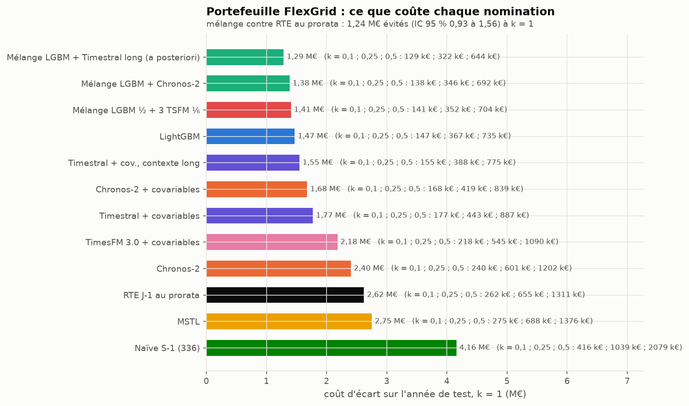
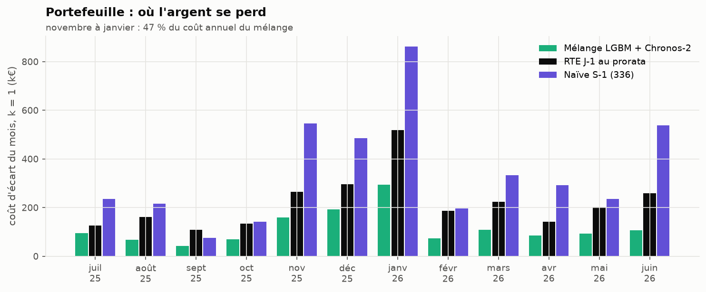
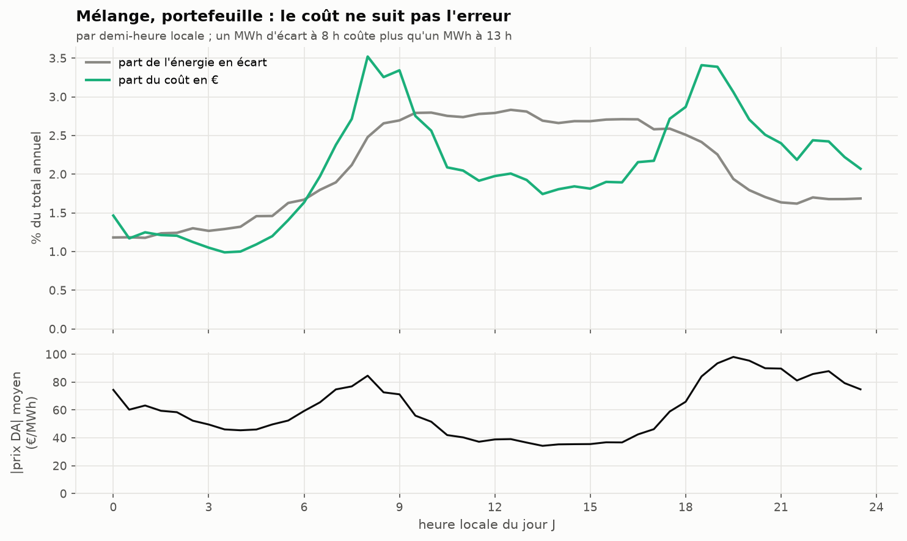

# Du MW à l'euro : le coût d'écart de la nomination

Le brief demande un « gain € estimé », avec le coût défini comme écart × prix. Les nombres viennent de
`uv run flexgrid tables` (`results/cost_portfolio.csv`, `results/verdicts_portfolio.csv`,
`results/cost_national_scaled.csv`) et les figures de `uv run flexgrid figures-results`.

## La règle de calcul, et ses limites

- Nomination = la médiane du modèle. Écart (MWh) = |réalisé − nomination| × 0,5 h, pour chaque pas du jour J.
- Coût = écart × |prix day-ahead| × k. **k = 1 est la définition du brief** : la valeur de l'énergie mal placée.
  C'est une borne haute. Un vrai coût d'écart est un *écart* de prix (prix de règlement des écarts moins prix
  day-ahead), que l'on ne peut pas télécharger sans compte (SPEC, angle mort 8). Les scénarios k = 0,1, 0,25 et
  0,5 donnent un ordre de grandeur plus réaliste.
- Le coût est proportionnel à k : **le classement des modèles et les ratios ne dépendent pas de k**. Seuls les
  montants en dépendent.
- Hors champ : le foisonnement avec d'autres portefeuilles du même BRP, les écarts de signe opposé qui se
  compensent dans un périmètre, et un éventuel ajustement intrajournalier. Le chiffre est un coût *avant* toute
  optimisation de l'équilibre.

## Le portefeuille FlexGrid, sur l'année de test

| Nomination | Écart (MWh/an) | Coût k = 1 | k = 0,1 | k = 0,25 | k = 0,5 |
|---|---|---|---|---|---|
| Mélange LightGBM + Chronos-2 | 22 514 | 1,38 M€ | 138 k€ | 346 k€ | 692 k€ |
| LightGBM | 23 146 | 1,47 M€ | 147 k€ | 367 k€ | 735 k€ |
| Chronos-2 + covariables | 27 682 | 1,68 M€ | 168 k€ | 419 k€ | 839 k€ |
| RTE J-1 au prorata | 46 215 | 2,62 M€ | 262 k€ | 655 k€ | 1 311 k€ |
| MSTL | 45 089 | 2,75 M€ | 275 k€ | 688 k€ | 1 376 k€ |
| Naïve S-1 | 62 827 | 4,16 M€ | 416 k€ | 1 039 k€ | 2 079 k€ |

**Coût évité par le mélange, sur l'année (k = 1, IC 95 % par blocs de 7 jours) :**

| contre | € évités | IC 95 % | à k = 0,25 |
|---|---|---|---|
| RTE J-1 au prorata | 1,24 M€ | [0,93 ; 1,56] M€ | 0,31 M€ |
| MSTL (meilleur modèle simple en MAE) | 1,37 M€ | [1,02 ; 1,67] M€ | 0,34 M€ |
| Naïve S-1 | 2,77 M€ | [1,97 ; 3,59] M€ | 0,69 M€ |

Lecture pour un BRP de 800 GWh : passer de la méthode sans modèle (≈ 6 % de MAPE) au mélange divise par deux
l'énergie en écart, soit **de l'ordre de 0,1 à 0,6 M€ par an selon la pénalité réelle**, et 1,2 M€ sous la
définition du brief. L'intervalle de confiance est large (± 25 %) parce qu'une année ne contient qu'un hiver, et
que l'hiver fait la moitié du coût.

## Où l'argent se perd

De novembre à janvier, trois mois font 47 % du coût annuel du mélange : la consommation et l'erreur montent
avec le chauffage, et le prix monte avec elles. Janvier seul (293 k€) coûte plus que tout l'été de juin à août (269 k€).

## Le coût n'est pas un MAE déguisé

L'erreur du mélange est étalée sur la journée de bureau. Son coût, lui, se concentre sur les deux bosses du prix
(8 h-9 h et 18 h-20 h). Le creux solaire de midi rend bon marché une erreur de mi-journée.

Conséquence mesurable : RTE au prorata se trompe surtout en milieu de journée, aux heures bon marché. Son MWh
d'écart coûte 56,7 € en moyenne, contre 61,5 € pour le mélange. Le mélange évite donc 51 % de l'énergie en écart,
mais seulement 47 % du coût. Le même effet existe au national (ci-dessous). **Un modèle qui viserait le coût
plutôt que le MAE** pondérerait ses erreurs par le prix attendu. Ce n'est pas fait ici : c'est une suite naturelle.

## Pourquoi on ne chiffre pas le national mis à l'échelle

Le SPEC (angle mort 6) annonçait que le national ramené à 800 GWh sous-estimerait le coût d'un portefeuille réel.
Mesuré (facteur d'échelle 0,0018) :

| Mélange | Écart (MWh/an) | Coût k = 1 |
|---|---|---|
| National mis à l'échelle de 800 GWh | 14 155 | 0,92 M€ |
| Portefeuille FlexGrid réel (815 GWh) | 22 514 | 1,38 M€ |

Le national moyenne des millions de sites : relativement à son énergie, il est 1,6 fois plus facile à prévoir.
Chiffrer un portefeuille sur le national ferait donc sous-estimer le coût d'un tiers.

Au national, le même décalage prix/erreur joue contre nous : le mélange a 36 % d'écart en moins que RTE brute en
MWh, mais 17 % seulement en € (0,92 M€ contre 1,12 M€ mis à l'échelle). Le biais de RTE culmine à midi, au creux
solaire du prix (bloc A).
