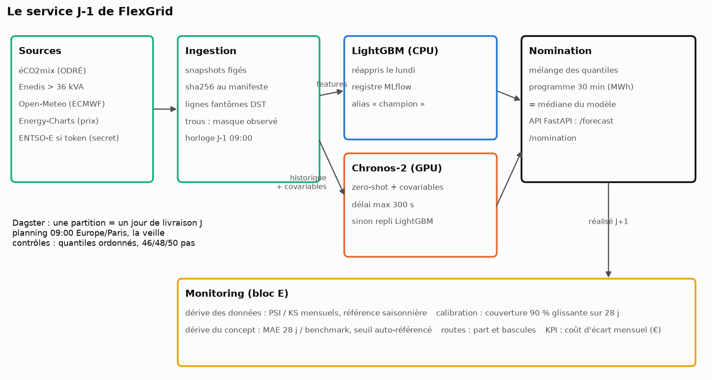
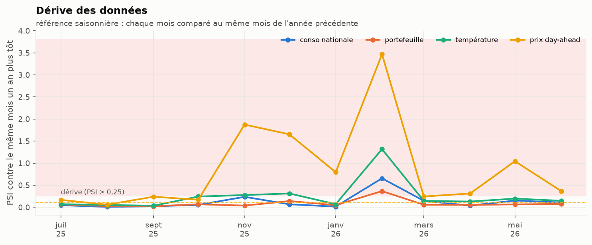
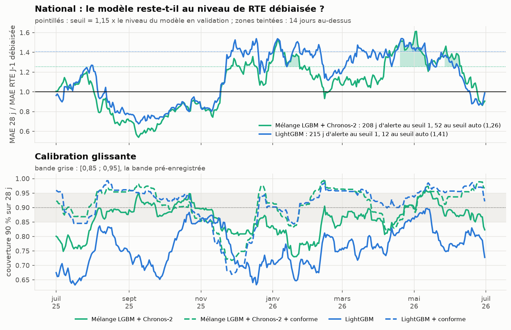
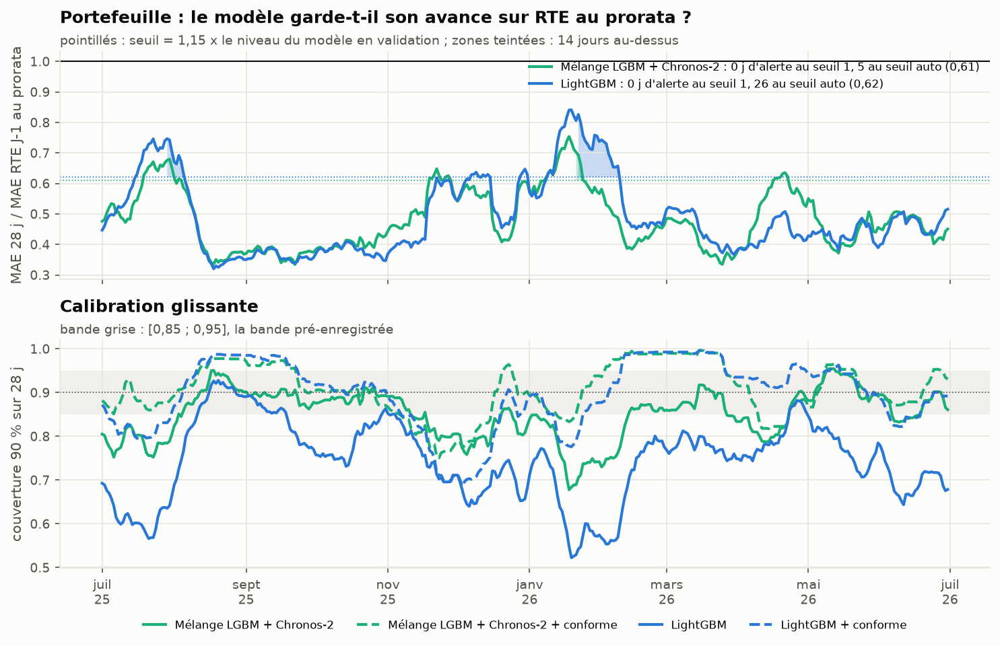

# Blocs D et E : le service J-1 et sa surveillance

Le brief demande une orchestration J-1, un registre de modèles, un service batch et une API de quantiles, des
conteneurs, un secret pour le token ENTSO-E (bloc D), puis une stratégie de monitoring (bloc E). Tout tourne ici en
local. Le monitoring est **rejoué** sur l'année de test : il n'y a pas eu de vraie mise en service, et on le dit.



## D. Le service

### Ce qui tourne

| Brique | Rôle | Fichier |
|---|---|---|
| Dagster | une partition = un jour de livraison J ; planning à 09:00 heure de Paris la veille | `src/flexgrid/prod/dagster_defs.py` |
| MLflow | registre : LightGBM quantile (7 boosters) emballé en modèle `pyfunc`, alias `champion` | `src/flexgrid/prod/registry.py` |
| Service | réapprentissage, prévisions LightGBM + Chronos-2, mélange, nomination | `src/flexgrid/prod/service.py` |
| FastAPI | `/health`, `/forecast/{famille}/{jour}` (quantiles), `/nomination/{famille}/{jour}` (MWh) | `src/flexgrid/prod/api.py` |
| Docker | une image, trois services (API, Dagster, MLflow) ; données et registre montés en volume | `Dockerfile`, `docker-compose.yml` |

La configuration est dans `configs/prod.yaml` : modèle nommé `ensemble` (le meilleur du backtest sur le
portefeuille), repli `lgbm` si Chronos-2 échoue ou dépasse 300 s (GPU absent, par exemple). Le repli est une
fonction du service : la raison est écrite à côté de la prévision (`<jour>.status.json`), et la nomination dit quel
modèle a été nommé.

```bash
uv sync --extra prod
DAGSTER_HOME=$PWD/dagster_home uv run dagster asset materialize -m flexgrid.prod.dagster_defs --select '*' --partition 2026-03-29
uv run uvicorn flexgrid.prod.api:app --port 8000
curl localhost:8000/nomination/segments/2026-03-29
```

### Ce qui a été vérifié

Trois partitions ont été matérialisées de bout en bout (journaux dans `logs/prod_<jour>.log`, non versionnés) :

| Jour de livraison | Pas attendus | Nomination national | Nomination portefeuille | Réapprentissage |
|---|---|---|---|---|
| 26 octobre 2025 (heure d'hiver) | 50 | 50 pas | 50 pas | oui (pas de champion valide) |
| 29 mars 2026 (heure d'été) | 46 | 46 pas | 46 pas | oui |
| 30 juin 2026 (mardi) | 48 | 48 pas | 48 pas | oui (réapprentissage hebdomadaire) |

- Le contrôle d'actif Dagster (quantiles ordonnés, nombre de pas du jour local) passe sur les trois.
- **La production reproduit le backtest.** Chronos-2 donne exactement les mêmes quantiles (écart 0,00 %). Pour
  LightGBM, le 30 juin, où le service et le backtest réapprennent à la même date, l'écart est aussi de 0,00 %. Les
  autres jours, l'écart moyen de la médiane est de 0,4 à 1,9 %. Il vient de la date de réapprentissage : le
  service, rejoué sur un jour isolé, réapprend ce jour-là, alors que le backtest garde le modèle du mardi.
- L'API sert les quantiles et la nomination, et renvoie 404 pour un jour non prévu. Un test (`tests/test_api.py`)
  le vérifie sur une journée de 50 pas.

### Un bug trouvé en rejouant le passé

La première exécution, sur le 26 octobre 2025, a utilisé pour le national le champion du registre, appris pour
le 30 juin 2026 : **un modèle qui avait vu huit mois de données postérieures à l'émission**. En service réel, cela
n'arrive pas : on avance dans le temps. Mais c'est exactement ce que fait un *backfill*. Règle ajoutée
(`dagster_defs.needs_refit`, testée) : un champion n'est réutilisé que s'il a été appris pour un jour de la semaine
qui précède, jamais après.

### Le token ENTSO-E

Le client ENTSO-E (`src/flexgrid/sources/entsoe.py`) lit le token dans `ENTSOE_TOKEN` ou dans le fichier désigné
par `ENTSOE_TOKEN_FILE`, monté par Docker comme secret (`.secrets/entsoe_token`, ignoré par git). Il n'apparaît
ni dans le code, ni dans la configuration, ni dans l'image. Faute de token, le service tourne sur éCO2mix et
Energy-Charts. Le client est testé sur une réponse XML enregistrée.

### Addendum du 2026-10-16 : le service garde le mélange LightGBM + Chronos-2

La règle était fixée avant les calculs (`configs/protocol.yaml`, `addendum_2026_10_16`, question 3) : un mélange
de l'addendum ne remplace `ensemble` que s'il a un MAE plus bas sur le portefeuille pendant la validation
(janvier-juin 2025), et l'année de test confirme ou infirme. Nombres : `results/production_switch.csv`
(`uv run flexgrid tables`).

| Mélange | MAE validation (MW) | Éligible | MAE test / `ensemble` (IC 95 %) |
|---|---|---|---|
| `ensemble` (LightGBM + Chronos-2, en service) | 2,92 | | 1 |
| LightGBM ½ + Chronos-2, Timestral, TimesFM ⅙ chacun | 2,84 | oui | 1,014 [0,988 ; 1,042] |
| LightGBM + Timestral | 2,90 | oui | 1,032 [0,999 ; 1,074] |
| LightGBM + TimesFM 3.0 | 3,11 | non | 1,147 [1,095 ; 1,200] |
| Les quatre à parts égales | 3,00 | non | 1,103 [1,057 ; 1,156] |
| LightGBM + Timestral contexte long (a posteriori) | 2,68 | non (a posteriori) | 0,930 [0,885 ; 0,984] |

Deux mélanges passent la validation ; l'année de test ne confirme ni l'un ni l'autre (« pas de différence »), et
chacun demanderait deux modèles de plus sur le GPU. **Le service ne change pas** : `nomination_model: ensemble`.
Le mélange avec Timestral à contexte long est le seul à faire mieux sur le test, mais il a été construit après
avoir vu le national : il sera candidat d'un prochain protocole, évalué sur une fenêtre qu'il n'a pas vue.

Timestral-5M tourne sur CPU ; il aurait pu servir de repli sans GPU. Il ne fait pas l'affaire : MAE de 5,36 MW sur
le portefeuille (`results/summary_portfolio.csv`), au niveau de RTE au prorata (5,28), contre 2,64 pour LightGBM,
qui reste le repli.

Licence : les poids de TimesFM 3.0 excluent l'usage commercial. Ce dépôt est une veille personnelle ; si un
mélange avec TimesFM avait été retenu, il n'aurait pas pu servir chez un vrai BRP sans autre licence.

### Ce qui manque pour une vraie production

- **L'ingestion temps réel.** Le service lit les snapshots figés de `data/raw/`. Brancher les API (éCO2mix,
  Enedis, Open-Meteo) demande une tâche d'ingestion par source, avec les mêmes contrôles qu'au bloc A. Les
  courbes de charge des sites, elles, viennent du gestionnaire de réseau par un canal contractuel, pas d'une API
  publique.
- **Un magasin de variables.** Les variables sont recalculées à chaque prévision (quelques secondes) : à cette
  échelle, un *feature store* n'apporterait rien de mesurable.
- **L'envoi de la nomination** au marché ou au gestionnaire d'équilibre : le service s'arrête au fichier.
- **Une image plus légère.** L'image construite (`docker build -t flexgrid-dayahead:local .`) sert l'API en
  conteneur, vérifié sur `/health` et `/nomination`. Elle pèse 6,9 Go compressés (20,8 Go sur disque), presque tout
  pour torch et CUDA. L'API seule n'a besoin ni de torch ni de LightGBM : une image séparée pour l'API la
  ramènerait à quelques centaines de Mo.
- **Chronos-2 dans le conteneur** a besoin d'un GPU (`deploy.resources` de Compose) ; sans GPU, le repli LightGBM
  prend le relais, ce qui coûte 3 % de MAE sur le portefeuille d'après le backtest (2,64 MW contre 2,57).

## E. La surveillance, rejouée sur l'année de test

Nombres : `results/monitoring_summary.json`, `results/monitoring_data_drift.csv`,
`results/monitoring_monthly_kpi.csv`. Figures : `uv run python -m flexgrid.figures_monitoring`.

### Dérive des données



Chaque mois de l'année de test est comparé au même mois de l'année précédente (PSI et KS). La référence est
saisonnière, sinon tout mois d'hiver « dériverait » par rapport à l'été. Seuil usuel : PSI > 0,25.
- **Le prix dérive la plupart des mois** (7 mois sur 12, PSI max 3,47 en février 2026). Ce n'est pas une alerte
  utile : le prix change de régime d'une année à l'autre. Il ne sert qu'à valoriser l'erreur, pas à prévoir.
- **Février 2026 dérive sur toutes les variables** : température (PSI 1,32), consommation nationale (0,66),
  portefeuille (0,37). Février 2026 a été 3 °C plus doux que février 2025 (9,2 °C contre 6,3 °C en moyenne
  nationale observée). Une dérive des entrées n'est pas une panne : les
  modèles l'ont absorbée, la figure suivante le montre.

### Dérive du concept : le modèle garde-t-il son niveau ?

Le brief demande « MASE/CRPS glissant vs baseline RTE ; alerte si dégradation persistante ». Le ratio suivi est le
MAE sur 28 jours du modèle divisé par celui de la référence. Une alerte sonne après 14 jours consécutifs au-dessus
du seuil.



**Le seuil naïf (« le modèle fait moins bien que la référence ») est inutilisable au national.** Il sonne 208 jours
sur 365 pour le mélange et 215 pour LightGBM : on sait depuis le backtest que le modèle est moins bon que RTE
débiaisée hors de l'été. Une alerte qui sonne la moitié de l'année n'est plus lue. Le seuil retenu est
**auto-référencé** : 1,15 fois le ratio du modèle sur la fenêtre de validation. Il sonne 52 jours pour le mélange
(mi-janvier, avril-mai et juin) et 12 pour LightGBM.



Sur le portefeuille, contre RTE au prorata, aucune alerte au seuil naïf : le modèle garde son avance toute
l'année. Le seuil auto-référencé sonne 5 jours pour le mélange (février) et 26 pour LightGBM (août et février),
quand le ratio remonte vers 0,75-0,85.

### Calibration

Le panneau du bas de chaque figure suit la couverture de l'intervalle 90 % sur 28 jours, la question du brief :
« un 90 % qui dérive à 70 % = perte d'argent ». C'est arrivé : la couverture brute de LightGBM descend à 0,52 sur le
portefeuille en janvier, et sous 0,65 au national. La réparation conforme la ramène dans la bande la plupart du
temps, mais elle suit avec retard les changements de saison : sur 28 jours glissants, la couverture du mélange
réparé tombe à 0,75 fin novembre sur le portefeuille (0,78 en moyenne sur le mois).

### Décision de routage

Suivie au bloc 03 (dérive des routes) : le stump bascule entre 0 et 50 segments selon la saison, 4,3 segments par
semaine en moyenne. Le service nomme le mélange, qui n'a pas de décision à surveiller.

### Le KPI de tête : le coût d'écart mensuel

| Mois | MAPE | Écart (MWh) | Coût k = 1 | Coût k = 0,25 | Couverture 90 % réparée |
|---|---|---|---|---|---|
| juil. 2025 | 2,9 % | 1 822 | 94 k€ | 24 k€ | 0,89 |
| août 2025 | 1,9 % | 1 232 | 67 k€ | 17 k€ | 0,98 |
| sept. 2025 | 1,9 % | 1 207 | 42 k€ | 10 k€ | 0,90 |
| oct. 2025 | 1,9 % | 1 227 | 69 k€ | 17 k€ | 0,88 |
| nov. 2025 | 3,4 % | 2 433 | 159 k€ | 40 k€ | 0,78 |
| déc. 2025 | 3,5 % | 2 749 | 193 k€ | 48 k€ | 0,89 |
| janv. 2026 | 3,5 % | 2 898 | 293 k€ | 73 k€ | 0,93 |
| févr. 2026 | 2,6 % | 1 650 | 73 k€ | 18 k€ | 0,99 |
| mars 2026 | 2,5 % | 1 716 | 108 k€ | 27 k€ | 0,93 |
| avr. 2026 | 3,1 % | 1 854 | 86 k€ | 21 k€ | 0,89 |
| mai 2026 | 3,1 % | 2 005 | 92 k€ | 23 k€ | 0,89 |
| juin 2026 | 2,5 % | 1 723 | 108 k€ | 27 k€ | 0,93 |

Mélange, portefeuille FlexGrid. C'est le tableau qu'un responsable d'équilibre regarderait chaque mois. Il dit
aussi la limite de ce chiffre : janvier coûte sept fois septembre pour une énergie en écart 2,4 fois plus grande,
parce que le prix et l'erreur montent ensemble en hiver.

### Ce que le rejeu ne montre pas

Le monitoring rejoué connaît déjà toute l'année. Les seuils ont été fixés après avoir vu la saturation du seuil
naïf : c'est une décision prise sur les données de test, déclarée dans les notes d'implémentation. Un vrai
monitoring les fixerait sur la validation et les garderait un an.
