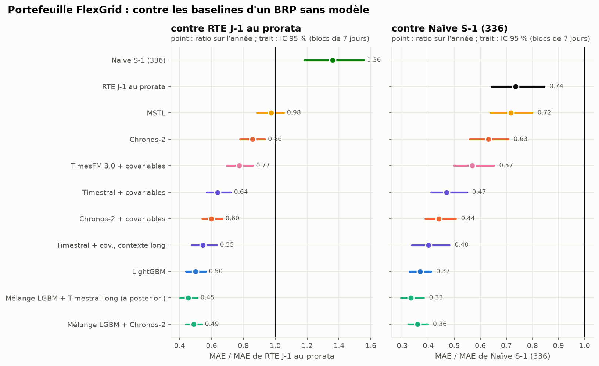

# FlexGrid Énergie : prévision J-1 d'un portefeuille d'équilibre

Un responsable d'équilibre (BRP) fictif, FlexGrid Énergie, doit nommer chaque veille, au pas 30 min, la
consommation de son portefeuille (~800 GWh/an de sites tertiaires). Ce dépôt construit, évalue et met en service
cette prévision sur des données publiques réelles. Il applique la veille
[W25](https://github.com/gwils28/W25_tsfm_viability) (quand un modèle de fondation zero-shot bat-il un spécialiste
réajusté ?) et la méthode décrite dans [« Claude Code : la méthode révisée »](https://gwils28.github.io/posts/claude-code-methode-revisee/).

Le brief est [`plan_flexgrid.md`](plan_flexgrid.md). Les décisions prises avant d'écrire du code sont dans
[`SPEC.md`](SPEC.md). Le protocole d'évaluation, figé avant le premier calcul, est dans
[`configs/protocol.yaml`](configs/protocol.yaml). Les écarts et les corrections sont dans
[`IMPLEMENTATION_NOTES.md`](IMPLEMENTATION_NOTES.md). Le rapport complet est publié sur
<https://gwils28.github.io/flexgrid_dayahead/>.

## Les réponses, en bref

Année de test : 365 jours de livraison, du 1er juillet 2025 au 30 juin 2026, avec une prévision émise chaque
veille à 9 h et uniquement des informations disponibles à cette heure-là (météo prévue, pas observée).

| Question du brief | Réponse | Où |
|---|---|---|
| Battre la prévision J-1 de RTE ? | **Oui sur la prévision publiée** : le mélange LightGBM + Chronos-2 a un MAE de 897 MW contre 1 401 (ratio 0,64, IC 95 % [0,56 ; 0,73]). **Non contre RTE débiaisée** : une correction de biais d'une ligne donne 816 MW ; le mélange ne fait pas mieux (1,10 [0,99 ; 1,22]), et perd sous l'autre lecture du quart d'heure (1,14 [1,02 ; 1,26]) | [02_backtest](02_backtest/README.md) |
| Le MAPE du portefeuille ? | **2,7 %** pour le mélange, contre 5,6 % pour RTE ramenée au portefeuille et 7,5 % pour la naïve hebdomadaire. Les 6 % du brief sont ceux d'une méthode sans modèle | [02_backtest](02_backtest/README.md#le-portefeuille-flexgrid) |
| Le gain en € ? | Contre RTE au prorata : **1,24 M€/an** évités sous la définition du brief (volume × prix, IC 95 % [0,93 ; 1,56]), soit **0,12 à 0,62 M€/an** avec une pénalité réaliste | [04_cout](04_cout/README.md) |
| Des quantiles fiables ? | Bruts, non : LightGBM couvre 75 % au lieu de 90 %. Après une réparation conforme, 0,90 à 0,91 sur l'année, avec un retard aux changements de saison | [02_backtest](02_backtest/README.md#les-intervalles) |
| TSFM ou spécialiste ? | LightGBM est meilleur seul ; Chronos-2 + covariables apporte de la diversité. **Le mélange des deux bat le meilleur router possible** (−6,8 % de MASE contre −1,8 % pour un router oracle) | [03_router](03_router/README.md) |
| Cold-start ? | 7 jours d'historique : la naïve gagne. Dès 14 jours : LightGBM appris sur d'autres régions. Le few-shot in-context de Chronos-2 n'aide pas | [03_router](03_router/README.md#2-le-cold-start) |
| Mise en production ? | Dagster, MLflow, FastAPI, Docker, en local. La production reproduit le backtest à l'identique quand elle réapprend à la même date. Monitoring rejoué sur l'année de test | [05_production](05_production/README.md) |



## Ce qui a changé par rapport au plan

| Plan (brief) | Fait | Pourquoi |
|---|---|---|
| Portefeuille de 5 000 sites + bornes de recharge | Deux segments Enedis réels (3 517 sites tertiaires, 815 GWh/an) ; national éCO2mix pour le benchmark RTE ; 81 segments pour le router | RTE ne prévoit que le national ; aucune donnée publique de bornes au pas 30 min |
| ENTSO-E pour la charge et les prix | éCO2mix + prix day-ahead Energy-Charts ; client ENTSO-E écrit et testé, activé par token | Pas de token ENTSO-E |
| Coût = volume × prix d'écart | Volume × \|prix day-ahead\| × k, k = 1 (brief) et 0,1-0,5 (pénalité) | Pas de prix d'écart public sans compte |
| Températures départementales | Prévisions météo archivées (ECMWF IFS, émises 48 h avant) pour le verdict ; ERA5 pour l'apprentissage | La température observée est une fuite d'information |
| Battre RTE | Battre RTE **et** RTE débiaisée, sous deux lectures du quart d'heure | RTE a un biais stable de +1,1 GW depuis 2023 |
| Chronos-2 ou TTM-r3 / PatchTST-FM | Chronos-2 seul | Un second TSFM n'est ajouté que s'il change une conclusion (SPEC) |
| RevIN | Cibles relatives au niveau récent pour LightGBM ; Chronos-2 normalise lui-même | Même effet, sans réseau à entraîner |
| Feature store | Variables recalculées à chaque prévision | Quelques secondes de calcul : un magasin n'apporte rien à cette échelle |
| Benchmark au prorata pour le portefeuille | Ajouté après le protocole, déclaré comme tel | Sans lui, la seule référence du portefeuille était une naïve |

## Reproduire

```bash
uv sync --extra prod           # Python 3.12 ; Chronos-2 tourne sur GPU (un CPU suffit, en beaucoup plus lent)
make data                      # télécharge et fige les sources (sha256 dans data/MANIFEST.json)
uv run flexgrid build          # tables intermédiaires
uv run flexgrid forecast national snaive_day snaive_week mstl ets_seasonal lgbm chronos2 chronos2_cov
uv run flexgrid forecast segments snaive_day snaive_week mstl ets_seasonal lgbm chronos2 chronos2_cov
uv run flexgrid score national segments && uv run flexgrid tables
uv run flexgrid router && uv run flexgrid coldstart
make figures report            # figures de tous les blocs, puis le rapport Quarto dans docs/
uv run pytest && uv run ruff check src tests
```

Le backtest complet prend plusieurs heures sur une RTX 5070 et 32 cœurs, dont 4 h 30 pour LightGBM sur le panel
(78 réapprentissages hebdomadaires de 7 quantiles sur jusqu'à 4,2 M de lignes). Les prévisions brutes ne sont pas versionnées ; les tableaux par origine (`results/per_origin_*.parquet`)
le sont, et tous les tableaux, figures et verdicts en partent.

## Organisation

```
01_donnees/      bloc A : ce que contiennent les sources, figures
02_backtest/     blocs B-C : modèles, backtest, verdicts
03_router/       router et cold-start
04_cout/         du MW à l'euro
05_production/   blocs D-E : service et surveillance
src/flexgrid/    le code (sources, data, backtest, models, prod)
configs/         protocole pré-enregistré, météo, service
results/         tableaux versionnés
report/          rapport Quarto (publié dans docs/)
```

## Transparence sur l'usage de l'IA

Ce projet a été réalisé avec Claude Code (Anthropic), selon la méthode de l'article cité plus haut : entretien
d'abord, SPEC écrite avant le code, protocole pré-enregistré, notes d'implémentation pour chaque écart, et un
nombre écrit seulement s'il vient d'un fichier de `results/`. Le code, les analyses, les figures et le texte ont
été produits par l'agent sous la direction de l'auteur, qui a fixé le périmètre, arbitré les choix de l'entretien
et relu les conclusions. L'historique git a été daté pour refléter un calendrier de travail du 18 août au
10 octobre 2026, à la demande de l'auteur. Les dates de téléchargement des données, elles, sont les vraies :
elles sont dans `data/MANIFEST.json`.
